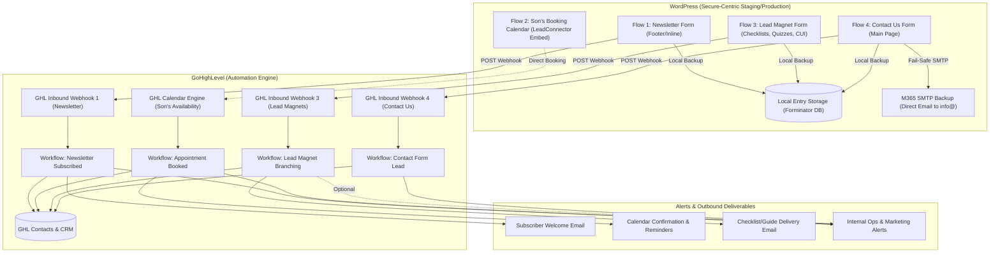

# Website ↔ GoHighLevel Integration Guide (Phase 1)
**Project**: Secure-Centric (WordPress & GoHighLevel Integration)  
**Authors/Roles**: Dhruval (WordPress / Frontend Engineering) & Ravi Sinha (GoHighLevel Automation Lead)  
**Reference Document**: `Website ↔ GoHighLevel Integration Requirements (Phase 1).docx`

---

## 🧭 System Architecture & Integration Blueprint



---

## 🏷️ Global GHL Prerequisites (Setup Once)

Before configuring individual workflows, configure the shared custom fields, tags taxonomy, and email sending domain inside GoHighLevel:

### 1. Custom Fields in GHL (`Settings` → `Custom Fields` → `Add Field`)
| Field Name | Type | Key in Payload | Description / Example |
|---|---|---|---|
| **Source Page URL** | Single Line Text | `source_page_url` | Full URL where form was submitted (e.g. `https://secure-centric.com/resources/checklist`) |
| **UTM Source** | Single Line Text | `utm_source` | Traffic source (e.g. `linkedin`, `google`, `newsletter`) |
| **UTM Medium** | Single Line Text | `utm_medium` | Marketing medium (e.g. `cpc`, `organic`, `referral`) |
| **UTM Campaign** | Single Line Text | `utm_campaign` | Campaign name (e.g. `q4-cmmc-readiness`) |
| **UTM Term** | Single Line Text | `utm_term` | Paid keywords or ad identifier |
| **UTM Content** | Single Line Text | `utm_content` | Specific creative / button variant |
| **Last Website Action** | Single Line Text | `last_website_action` | Form action (e.g. `Newsletter signup`, `Contact form submission`) |
| **Lead Magnet Name** | Single Line Text | `lead_magnet_name` | Name of downloaded asset (e.g. `CMMC Readiness Checklist`) |
| **Contact Form Message** | Multi-Line Text | `contact_form_message` | Raw inquiry message from the visitor |

### 2. Standard Tag Taxonomy in GHL
- `source - website`: Added to **every** contact originating from any website interaction.
- `website - newsletter`: Added on newsletter subscription.
- `website - meeting booked`: Added when an appointment with Son is scheduled.
- `website - lead magnet - <resource-name>`: Added on checklist or guide downloads.
- `website - quiz - <quiz-name>`: Added on compliance quiz completion.
- `website - cui assessment`: Added on 30-minute CUI assessment opt-in.
- `website - contact form`: Added on Contact Us form submissions.

### 3. Dedicated Sending Subdomain (DNS)
- Configure an authorized mail subdomain in GHL (`Settings` → `Email Services` → `Dedicated Domain`), e.g., `mg.secure-centric.com` or `mail.secure-centric.com`.
- Add SPF, DKIM, and DMARC TXT records in Cloudflare/DNS so confirmation emails do not trigger spam filters or look like phishing.

---

## 🚀 Flow-by-Flow Implementation Steps

---

### Flow 1: Newsletter Signup (Footer & Inline Blocks)

#### A. Steps in GoHighLevel (Ravi)
1. **Create Inbound Webhook**:
   - Go to **Automation** → **Workflows** → **Create Workflow** → **Start from Scratch**.
   - Name: `[Website] Flow 1 - Newsletter Signup`.
   - Add Trigger: **Inbound Webhook**.
   - Copy the generated Webhook URL (provide this to Dhruval).
2. **Configure Workflow Actions**:
   - **Step 1 - Create/Update Contact**:
     - Map `email` → `Contact.Email` (lookup key).
     - Map `first_name` → `Contact.First Name` (if present).
     - Map `source_page_url` → `Contact.Source Page URL`.
     - Map `utm_*` fields to their respective custom fields.
   - **Step 2 - Add Tags**:
     - Add `source - website`.
     - Add `website - newsletter`.
   - **Step 3 - Update Field**:
     - Set `last_website_action` = `Newsletter signup`.
   - **Step 4 - Send Confirmation Email (Template A)**:
     - **Subject**: *You're subscribed to Secure-Centric updates*
     - **Body**:
       ```text
       Hi {{contact.first_name | default: 'there'}},

       Thanks for subscribing. You'll now receive practical updates on CMMC, NIST SP 800-171, and protecting CUI from the Secure-Centric team.

       A quick note: this email is sent through our secure email platform, so the sender address may reflect our delivery gateway. Our official website is www.secure-centric.com.

       Talk soon,
       The Secure-Centric Team
       ```
   - **Step 5 - Internal Notification (Template B)**:
     - Send Internal Email / Slack / In-App Notification to **Operations & Marketing**.
     - **Subject**: `New newsletter subscriber: {{contact.email}}`
     - **Body**: Details subscriber email, source page, and UTM parameters.
3. **Publish Workflow**.

#### B. Steps in WordPress (Dhruval)
1. **Forminator Setup**:
   - Form Name: `Newsletter Signup`.
   - Fields:
     - `email` (Required).
     - `first_name` (Optional / hidden on compact footer).
     - Hidden field: `source_page_url` (Value: `{embed_url}`).
     - Hidden fields: `utm_source`, `utm_medium`, `utm_campaign` (Auto-extracted from URL query parameters via JS/Forminator default query vars).
2. **Spam & Security Settings**:
   - Enable **Cloudflare Turnstile** or reCAPTCHA v3.
   - Enable Forminator **Honeypot protection**.
3. **Connect Webhook**:
   - Under Form Settings → **Integrations** → **Webhook**:
   - Paste the GHL Webhook URL provided by Ravi.
   - Send data as `POST (JSON)`.
4. **UX & Confirmation**:
   - Select AJAX submission (no page reload).
   - Inline message: *"Thanks, you're subscribed to Secure-Centric updates."*
5. **Analytics Event**:
   - In form footer JS, hook successful submit:
     ```javascript
     window.dataLayer = window.dataLayer || [];
     window.dataLayer.push({
       event: 'newsletter_signup',
       form_id: 'newsletter_footer'
     });
     ```

---

### Flow 2: Schedule a Call with Son (Meeting Scheduler)

#### A. Steps in GoHighLevel (Ravi)
1. **Configure Son's Availability**:
   - Go to **Settings** → **Calendars**.
   - Create or edit calendar: `Consultation with Son (30 Min)`.
   - Set Son as the assigned user, set meeting duration to 30 mins, configure working buffers and notice period.
2. **Calendar Form & Settings**:
   - Require: First Name, Last Name, Work Email, Phone, Company Name.
   - Enable confirmation page or custom redirect.
   - Enable GHL native Google/Outlook calendar 2-way sync so Son gets the invite automatically.
3. **Automated Booking Workflow**:
   - Go to **Automation** → **Workflows** → **Create Workflow**.
   - Name: `[Website] Flow 2 - Meeting Booked with Son`.
   - Add Trigger: **Appointment Status**.
     - Event Type: `Normal`
     - In Calendar: `Consultation with Son (30 Min)`
     - Appointment Status: `Confirmed / Booked`
   - **Step 1 - Add Tags**:
     - Add `source - website`.
     - Add `website - meeting booked`.
   - **Step 2 - Update Field**:
     - Set `last_website_action` = `Meeting booked with Son`.
   - **Step 3 - Pipeline Opportunity (Optional)**:
     - Create/Update Opportunity in `Sales Pipeline` under stage `Meeting Booked`.
   - **Step 4 - Internal Notification (Template C)**:
     - Send notification to **Operations & Marketing**.
     - **Subject**: `New call booked with Son: {{contact.name}} ({{contact.company_name}})`
     - **Body**: Include meeting time `{{appointment.start_time}}`, phone, email, and source page.
4. **Export Embed Code / URL**:
   - Copy the LeadConnector widget iframe code or URL:  
     `https://api.leadconnectorhq.com/widget/booking/nZAjs4Kt86aEyfpwhcll`

#### B. Steps in WordPress (Dhruval)
1. **Lazy-Load Embed Implementation**:
   - Implement the calendar embed inside a dedicated modal or container on `/contact/` and the CUI landing page:
     ```html
     <iframe 
       src="https://api.leadconnectorhq.com/widget/booking/nZAjs4Kt86aEyfpwhcll" 
       style="width: 100%; border:none; min-height: 650px;" 
       scrolling="no" 
       loading="lazy"
       id="ghl-booking-frame">
     </iframe>
     <script src="https://link.msgsndr.com/js/form_embed.js" type="text/javascript"></script>
     ```
   - Using `loading="lazy"` ensures zero impact on initial page speed and Core Web Vitals.
2. **Button Wiring**:
   - All primary buttons ("Schedule a 30-Minute Consultation", "Talk to an Expert") link directly to this calendar.
3. **Analytics**:
   - Listen for GHL iframe message events (`postMessage` from `msgsndr.com` / `leadconnectorhq.com`) to fire GA4 event:
     ```javascript
     window.addEventListener('message', function(e) {
       if (e.data && (e.data.event === 'booking_successful' || e.data.action === 'appointment_booked')) {
         window.dataLayer.push({ event: 'schedule_consultation_booked' });
       }
     });
     ```

---

### Flow 3: Lead Magnet Activity (Checklists, Quizzes, CUI Assessment)

#### A. Steps in GoHighLevel (Ravi)
1. **Create Inbound Webhook**:
   - Name: `[Website] Flow 3 - Lead Magnet & Resource Downloads`.
   - Trigger: **Inbound Webhook**.
   - Copy the Webhook URL.
2. **Configure Multi-Branch Workflow**:
   - **Step 1 - Create/Update Contact**:
     - Map `email`, `first_name`, `last_name`, `company_name`, `source_page_url`, `utm_*`.
   - **Step 2 - Global Tag**:
     - Add `source - website`.
   - **Step 3 - If/Else Condition Branch**:
     - **Branch 1: Checklist Download** (Condition: `activity_type` equals `checklist_download`):
       - Add Tag: `website - lead magnet - {{lead_magnet_slug}}` (e.g. `website - lead magnet - cmmc readiness checklist`).
       - Set `last_website_action` = `Resource download`.
       - Set `lead_magnet_name` = `{{lead_magnet_name}}`.
       - Send Email to contact with the download link and follow-up guidance.
     - **Branch 2: Quiz Completion** (Condition: `activity_type` equals `quiz`):
       - Add Tag: `website - quiz - {{quiz_slug}}`.
       - Set `last_website_action` = `Quiz completed`.
       - Send Email with scorecard summary.
     - **Branch 3: Free 30-Min CUI Assessment Opt-in** (Condition: `activity_type` equals `cui_assessment`):
       - Add Tag: `website - cui assessment`.
       - Set `last_website_action` = `CUI assessment request`.
       - Send Immediate Alert to Senior Advisory Team.
   - **Step 4 - Internal Notification (Template D)**:
     - Built and ready (switched inactive by default, easily enabled by Sayan).
3. **Publish Workflow**.

#### B. Steps in WordPress (Dhruval)
1. **Forminator Template**:
   - Form Name: `Resource Download Gated Form`.
   - Fields:
     - First Name, Last Name, Work Email, Company Name.
     - Hidden: `activity_type` (e.g. `checklist_download`).
     - Hidden: `lead_magnet_name` (e.g. `CMMC Readiness Checklist`).
     - Hidden: `lead_magnet_slug` (e.g. `cmmc-readiness-checklist`).
     - Hidden: `source_page_url` and UTMs.
2. **Spam & Local Storage**:
   - Enable Turnstile & Honeypot.
   - Forminator stores every submission locally in the WordPress database under **Forminator → Submissions** as an immutable backup.
3. **Direct Delivery on Screen**:
   - On submit, show a prominent **"Download Your Checklist (PDF)"** button immediately on screen while simultaneously emailing the link. This prevents frustration if the email is delayed.
4. **Connect Webhook**:
   - Send JSON payload to GHL Flow 3 Webhook URL.

---

### Flow 4: Contact Us Form (Main Inbound Inquiry)

> [!IMPORTANT]
> The Contact Us form is the most critical conversion point on the website. To guarantee that **no inquiry is ever lost**, this flow uses **fail-safe dual delivery**: GHL receives the lead via server-side webhook, and WordPress simultaneously transmits a direct backup copy to `info@secure-centric.com` via Microsoft 365 SMTP.

#### A. Steps in GoHighLevel (Ravi)
1. **Create Inbound Webhook**:
   - Name: `[Website] Flow 4 - Contact Us Form`.
   - Trigger: **Inbound Webhook**.
   - Copy Webhook URL.
2. **Configure Workflow Actions**:
   - **Step 1 - Create/Update Contact**:
     - Map `first_name`, `last_name`, `email`, `phone`, `company_name`.
     - Map `contact_form_message` → Custom field **Contact form message**.
     - Map `source_page_url` and UTM parameters.
   - **Step 2 - Add Tags**:
     - Add `source - website`.
     - Add `website - contact form`.
   - **Step 3 - Update Field**:
     - Set `last_website_action` = `Contact form submission`.
   - **Step 4 - Internal Alert (Template E)**:
     - Send notification email to `info@secure-centric.com`, Operations, and Marketing.
     - **Subject**: `New website enquiry from {{contact.name}}, {{contact.company_name}}`
     - **Body**: Complete contact data, full message body, phone number, and originating URL.
   - **Step 5 - Prospect Auto-Reply**:
     - Send reassurance email: *"Thank you for contacting Secure-Centric. Our CMMC advisory team has received your message and will respond within one business day."*
3. **Publish Workflow**.

#### B. Steps in WordPress (Dhruval)
1. **Forminator Form Configuration**:
   - Form Name: `Contact Us Main`.
   - Fields:
     - First Name (Required).
     - Last Name (Required).
     - Work Email (Required).
     - Phone Number (Optional / Recommended).
     - Company Name (Required).
     - Message / "How can we help?" (Required).
     - Hidden: `source_page_url`, `utm_source`, `utm_medium`, `utm_campaign`.
2. **Dual-Route Configuration**:
   - **Route 1 (GoHighLevel Webhook)**:
     - Under Form Settings → **Integrations** → **Webhook**: Add GHL Flow 4 Webhook URL.
   - **Route 2 (Direct Email via SMTP)**:
     - Under Form Settings → **Email Notifications**:
     - Recipient: `info@secure-centric.com`.
     - Subject: `[Website Contact Form Backup] Submission from {name-1} {name-2} - {text-1}`.
     - Body: `{all_fields}`.
     - Delivered through authenticated Microsoft 365 SMTP (WP Mail SMTP plugin).
3. **Local Database Entry**:
   - Entries are saved in WordPress database (`wp_posts` / `wp_forminator_entries`). If GHL experiences a service interruption, every submission remains safe and accessible in WP Admin.
4. **UX & Spam Protection**:
   - Turnstile + Honeypot active.
   - Clean AJAX inline response: *"Thank you. Your inquiry has been sent to our advisory team."*
5. **Analytics**:
   - Fire GA4 conversion event:
     ```javascript
     window.dataLayer.push({
       event: 'generate_lead',
       lead_type: 'contact_form'
     });
     ```

---

## 🔒 Security, Tracking & Best Practices

1. **Server-Side Webhook Protection**:
   - Webhook URLs can be stored securely as constants in `wp-config.php` (e.g. `define('GHL_NEWSLETTER_WEBHOOK', 'https://services.leadconnectorhq.com/hooks/...');`) rather than exposing raw URLs in client-side HTML or scripts.
2. **UTM Persistence Across Site Visits**:
   - Add a lightweight cookie/localStorage script to remember `utm_source`, `utm_medium`, and `utm_campaign` if a visitor browses multiple pages before submitting a form.
3. **Deduplication Logic**:
   - In GHL, all contact lookups must key on `email`. Submitting a form multiple times will update the existing contact's fields and trigger the workflow each time without creating duplicate contact records.
4. **GDPR / Privacy Compliance**:
   - Each form displays the mandatory micro-copy:  
     *"By submitting, you agree to Secure-Centric's [Privacy Policy](/privacy-policy/). Unsubscribe at any time."*

---

## 📋 Comprehensive Staging Test Checklist

| # | Test Item | Verification Criteria | Status |
|---|---|---|:---:|
| 01 | **Newsletter Form** | Submitting creates contact with `source - website`, `website - newsletter`, and triggers Template A. | [ ] |
| 02 | **Calendar Booking** | Booking with Son triggers appointment workflow, tags `website - meeting booked`, and sends Google invite. | [ ] |
| 03 | **Lead Magnet Download** | Form submits, instant download button displays, GHL tags `website - lead magnet - <name>`, and emails asset. | [ ] |
| 04 | **Contact Us Form** | Form creates contact with full message in GHL **AND** sends backup copy to `info@secure-centric.com` via M365 SMTP. | [ ] |
| 05 | **Duplicate Submission** | Submitting the same email twice updates the existing contact without duplicating and re-triggers notification. | [ ] |
| 06 | **Spam Prevention** | Honeypot or bot test fails silently in browser and never dispatches payload to GHL. | [ ] |
| 07 | **UTM Parameter Passing** | Visiting with `?utm_source=linkedin&utm_campaign=q4` records correct values in GHL contact custom fields. | [ ] |
| 08 | **GA4 Conversion Events** | Form submissions fire `newsletter_signup` and `generate_lead` events into `window.dataLayer`. | [ ] |
| 09 | **Email Delivery Verification** | Confirmation emails pass SPF, DKIM, DMARC checks and land in primary inbox (not Spam/Promotions). | [ ] |
| 10 | **Mobile Responsiveness** | All forms and calendar embeds render cleanly across iOS and Android viewports without viewport glitch. | [ ] |
